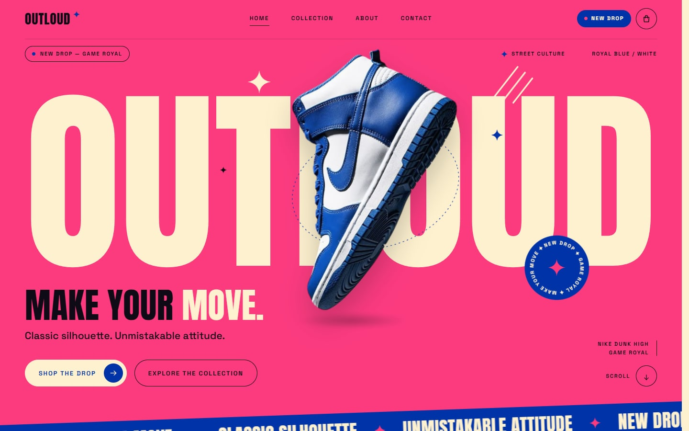
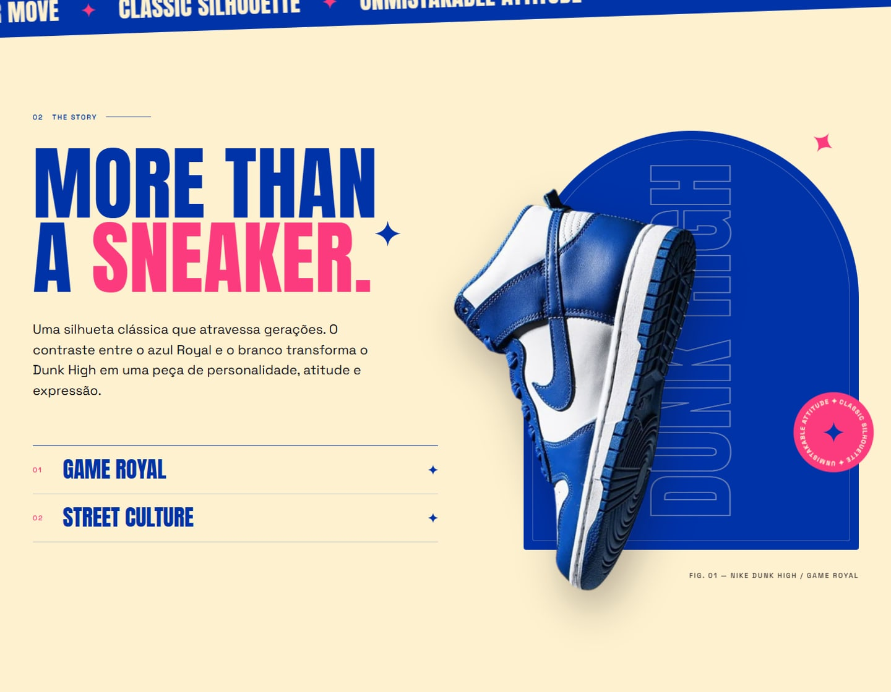
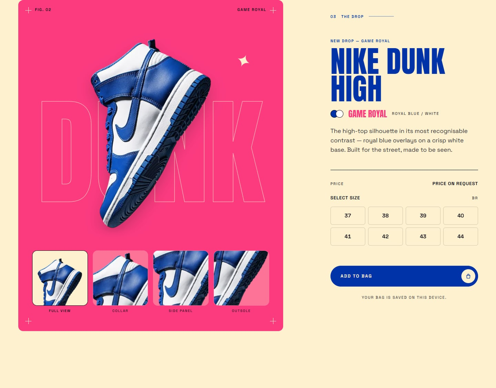
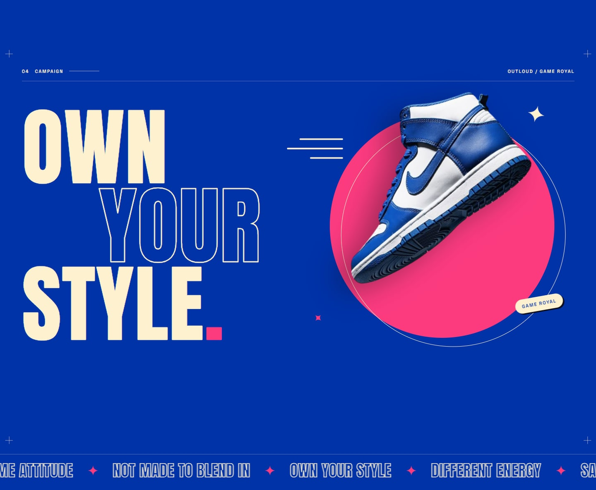
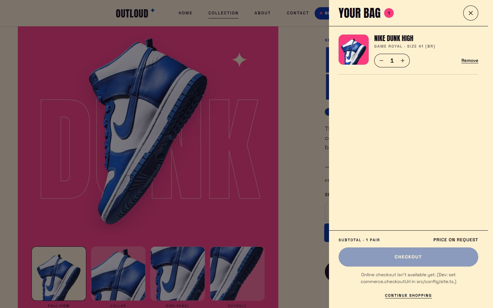
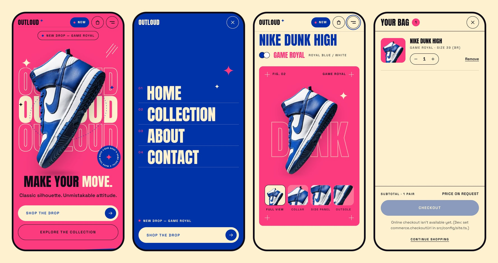

<div align="center">

# OUTLOUD — Sneaker Drop Landing Page

**Landing page de lançamento com direção de arte Y2K / editorial streetwear, carrinho funcional e foco em acessibilidade e performance.**




</div>

---

## Sobre o projeto

**OUTLOUD** é uma landing page de campanha para o **Nike Dunk High “Game Royal”**, construída como projeto de portfólio para demonstrar, de ponta a ponta, o que une design e engenharia frontend:

- **Direção de arte própria** — tipografia oversized, composição editorial, selos giratórios, marquee inclinado e microcopy no estilo de campanha de marca de streetwear.
- **Engenharia de produto real** — seletor de tamanho acessível, carrinho com estado persistido, validações e estados vazios/erro tratados.
- **Qualidade mensurável** — Core Web Vitals, navegação por teclado, `prefers-reduced-motion`, 11 larguras de tela verificadas sem scroll horizontal.

> **Projeto de portfólio, sem fins comerciais.** Nike e Dunk são marcas registradas da Nike, Inc. Nenhum preço, estoque, avaliação ou especificação técnica foi inventado: tudo que é comercial é configurável e, quando vazio, a interface mostra um estado honesto (“Price on request”, “coming soon”).

---

## Destaques para quem avalia

| | |
| --- | --- |
| **Hero adaptável** | O wordmark preenche exatamente a largura da tela para qualquer nome de marca (hook `useFitText`), com o produto sobreposto em camadas controladas. |
| **Carrinho sem biblioteca de estado** | `useReducer` + Context, reducer puro e testável, persistência defensiva em `localStorage` que descarta dados inválidos. |
| **Acessibilidade de verdade** | Radios nativos no seletor de tamanho, focus trap em menu e carrinho, `inert` no conteúdo de fundo, live region para anúncios, skip link, retorno de foco ao fechar. |
| **Performance** | Imagens em AVIF/WebP com `srcset`, dimensões fixas (CLS 0), fontes self-hosted com preload, imagem do hero preloaded, JS de 79 KB gzip (quase tudo é React). |
| **Zero dependências de UI/animação** | Animações em CSS (scroll-timeline quando suportado), tudo desativado com `prefers-reduced-motion`. |
| **Uma única fonte de configuração** | Marca, preço, tamanhos, checkout e contatos em um só arquivo; o `<head>` (SEO/Open Graph) é gerado a partir dele em build-time. |

---

## Galeria

### Desktop

<table>
  <tr>
    <td width="50%"><br /><sub><b>Product story</b> — arco azul com o tênis rompendo o quadro</sub></td>
    <td width="50%"><br /><sub><b>Product details</b> — galeria, tamanhos e Add to bag</sub></td>
  </tr>
  <tr>
    <td width="50%"><br /><sub><b>Campaign</b> — tipografia oversized com contorno</sub></td>
    <td width="50%"><br /><sub><b>Bag</b> — drawer com quantidade, remoção e subtotal</sub></td>
  </tr>
</table>

### Mobile (projetado à parte, não só reduzido)

<div align="center">
  
  <br /><sub>Hero · menu em tela cheia · produto · sacola</sub>
</div>

---

## Stack e decisões técnicas

| Camada | Escolha | Por quê |
| --- | --- | --- |
| Framework | **React 19 + TypeScript** (strict) | Componentes pequenos, tipos em todo o fluxo do carrinho. |
| Build | **Vite 8** | Build em < 0,5 s; plugin próprio injeta SEO a partir da config. |
| Estilo | **CSS puro + design tokens** | Paleta, escala tipográfica (`clamp()`), espaçamentos e motion em `tokens.css`; sem peso de framework. |
| Estado | **`useReducer` + Context** | O domínio é pequeno; um reducer puro dá previsibilidade sem dependências. |
| Qualidade | **oxlint + `tsc -b`** | Zero warnings e zero erros de tipo no build. |

### Paleta oficial

| Cor | Hex | Uso |
| --- | --- | --- |
| Rosa | `#FC3B7F` | Identidade, hero, rodapé, áreas de impacto |
| Creme | `#FEF1CF` | Tipografia de destaque, respiro, cards |
| Azul Royal | `#0032A8` | Conexão com o produto, navegação, CTA secundário |

Tipografia: **Anton** (display) + **Space Grotesk** (texto), ambas OFL e hospedadas no projeto.

---

## Arquitetura

```
src/
├── config/        site.ts (marca, produto, preço, checkout, contatos) · navigation.ts
├── cart/          cartStore.ts (reducer + persistência) · CartProvider · useCart
├── components/
│   ├── layout/    Header · MobileMenu · Footer
│   ├── sections/  HeroSection · ProductStory · ProductDetails · CampaignSection · BrandStatement
│   ├── product/   ProductImage · ProductGallery · SizeSelector
│   ├── cart/      CartDrawer · CartLineItem · QuantityStepper
│   └── ui/        Button · Marquee · Decor (sparkle, badge, linhas) · Icons
├── hooks/         useRevealOnScroll · useFitText · useFocusTrap · useScrollLock
│                  useHeaderState · useActiveSection
├── lib/           format · productImage · scroll
└── styles/        tokens.css · base.css
public/            images (AVIF/WebP) · fonts (woff2) · favicons · og-image.jpg
docs/screenshots/  imagens usadas neste README
```

Princípios: responsabilidade única por componente, lógica de domínio fora da UI (`cartStore.ts` é independente de React), hooks reutilizáveis para comportamento transversal e nenhum componente gigante.

---

## Funcionalidades

- **Seletor de tamanho** — radios nativos, estados selecionado/indisponível, validação com foco e mensagem acessível antes de adicionar.
- **Carrinho** — adicionar, alterar quantidade (limite configurável), remover, subtotal, estado vazio e persistência entre recargas.
- **Checkout honesto** — nenhum pagamento é simulado: o botão fica desativado com aviso até `commerce.checkoutUrl` ser configurado.
- **Navegação** — âncoras com foco gerenciado, header que se recolhe ao rolar, indicação da seção ativa, menu mobile em tela cheia.
- **Galeria** — recortes ampliados da mesma foto do produto (sem sugerir ângulos inexistentes).
- **Movimento com critério** — entrada do hero, flutuação do tênis, marquee e reveal no scroll; tudo respeita `prefers-reduced-motion`.

---

## Como rodar

Requisitos: **Node.js 20.19+** (exigência do Vite 8).

```bash
git clone https://github.com/kkaua05/outloud-landing-page.git
cd outloud-landing-page
npm install

npm run dev        # desenvolvimento em http://localhost:5173
npm run build      # type-check + build de produção em dist/
npm run preview    # serve o build de produção
npm run lint       # oxlint
```

## Configuração

Tudo o que é comercial ou de marca fica em [`src/config/site.ts`](src/config/site.ts):

| Campo | Função | Estado |
| --- | --- | --- |
| `brand.name` | Nome da marca (UI, wordmarks, `<title>`, Open Graph) | `OUTLOUD` (provisório) |
| `product.price` | Preço unitário; `null` mostra “Price on request” | não definido |
| `product.currency` / `locale` | Formatação do preço | `BRL` / `pt-BR` |
| `product.sizes` | Numerações e disponibilidade manual | 37–44 (sem ligação a estoque) |
| `commerce.checkoutUrl` | Checkout externo (Shopify, Stripe Payment Link…) | não definido |
| `contact.*` | E-mail e Instagram do rodapé | não definido |
| `seo.siteUrl` | URL de produção para Open Graph | não definido |

---

## Qualidade verificada

Medido no build de produção, em Chrome, com rede ~1,6 Mbps / 150 ms RTT e CPU 4× mais lenta (perfil mobile):

| Métrica | Resultado |
| --- | --- |
| LCP (mobile throttled) | **2,36 s** |
| CLS | **0** |
| Peso total da página | **202 KB** (JS 79 KB gzip · CSS 10 KB gzip · imagem do hero 75 KB AVIF) |
| Larguras sem scroll horizontal | 320 · 360 · 375 · 390 · 414 · 768 · 1024 · 1280 · 1366 · 1440 · 1920 |
| Erros/avisos no console | 0 |
| `tsc -b` · `oxlint` | 0 erros · 0 avisos |

Fluxos validados em navegador real (40 verificações automatizadas): validação de tamanho, adição ao carrinho, quantidade, remoção, persistência após reload, estado vazio, menu mobile, galeria, âncoras, ordem de foco, fechamento por `Esc` e retorno de foco.

---

## Sobre a imagem do produto

O recorte do tênis foi feito reaplicando a máscara do PNG recortado sobre a foto original (resolução maior), com remoção do halo cinza nas bordas. Forma, proporções e cores do produto **não foram alteradas**. A foto é referência de terceiros usada apenas para fins de portfólio; para uso comercial, substitua por imagens com direitos adequados.

## Próximos passos

- Integrar checkout real via `commerce.checkoutUrl` (Shopify/Stripe).
- Substituir a foto por um conjunto com múltiplos ângulos em alta resolução.
- Testes automatizados (Vitest para o reducer do carrinho, Playwright para os fluxos).

---

## Autor

Feito por **[@kkaua05](https://github.com/kkaua05)**. Se o projeto te interessou, fico à disposição para conversar.

## Licença

Código sob licença [MIT](LICENSE). Marcas e imagem do produto pertencem a seus respectivos titulares.
